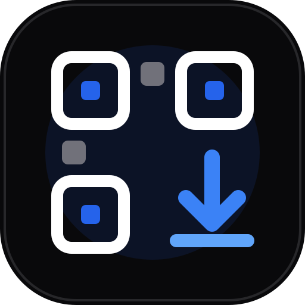

<p align="center">
  
</p>

<h1 align="center">QRDown</h1>

<p align="center">
  <strong>Direct, air-gapped optical and peer-to-peer file transfer in the browser.</strong><br />
  Stream files visually across physical gaps with animated QR codes or transfer directly over WebRTC. Zero installations, zero tracking.
</p>

<p align="center">
  <a href="https://qrdown.vercel.app"><strong>Open Application</strong></a> •
  <a href="#core-transmission-modes">Transmission Modes</a> •
  <a href="#optical-transfer-protocol-ws2">Protocol Specs</a> •
  <a href="#self-hosting--development">Self-Hosting</a>
</p>

---

## Overview

QRDown provides two independent, high-performance file transfer methods directly within modern web browsers without requiring accounts or native applications:

1. **Air-Gapped Optical Transfer**: Converts files into an animated stream of high-density QR codes rendered on-screen and captured by a receiving device's camera. Operates 100% offline with zero radio signals, local network connection, or Bluetooth required.
2. **Direct Peer-to-Peer Transfer**: Establishes an end-to-end encrypted WebRTC `RTCDataChannel` for direct network transfers with automatic STUN/TURN traversal and encrypted cloud fallback for restrictive NAT environments.

---

## Core Transmission Modes

### 1. Optical Visual Transmission
* **Air-Gapped**: Physically isolated devices exchange files via screen-to-camera optical paths.
* **Resilient Decoding**: Built-in multi-threaded video processing using Web Workers and `OffscreenCanvas` to scan and decode at 60 FPS without UI jank.
* **Integrity Auditing**: Independent SHA-256 checksum calculation executed on the receiver before file reconstruction.
* **Payload Density**: High-density Base45 alphanumeric encoding with automatic gzip stream compression for text and structured data.

### 2. Direct Network Transmission (WebRTC)
* **Zero Intermediary**: Files flow directly between browser memory buffers via WebRTC data channels.
* **Room Coordination**: Ephemeral 6-digit room codes or scannable QR pairing links for immediate connection.
* **Symmetric NAT Traversal**: Configured for automated TURN relay negotiation via Cloudflare Realtime TURN or coturn.
* **Encrypted Fallback**: Automatic failover to temporary encrypted storage (Cloudflare R2 / S3) if direct network connectivity cannot be negotiated.

---

## Optical Transfer Protocol (WS2)

The optical transfer engine translates binary data into high-throughput sequential QR frames optimized for camera sensor capture.

### Encoding Architecture
* **Alphanumeric Base45**: Encodes byte streams into the standard QR alphanumeric character set (`0-9`, `A-Z`, ` $%*+-./:`). This achieves significantly higher bit density per square millimeter compared to generic binary or base64 QR payloads.
* **Gzip Pre-compression**: Files are evaluated through `CompressionStream("gzip")` before chunking; compression is applied only when it reduces total chunk count.
* **Cyclic Header Interleaving**: Metadata header frames repeat every 16 chunks so receivers can establish context mid-stream without waiting for an entire transmission cycle to restart.
* **Backward Compatibility**: Automatically detects and ingests legacy `WS1` base64 frames.

### Frame Schemas

#### Header Frame (`WS2:H`)
Broadcasts transfer metadata to initialize the receiving accumulator:
```text
WS2:H:<12-HEX-ID>:<BASE45_JSON_METADATA>
```
* **Payload Structure**: `[fileName, mimeType, byteSize, transferSize, totalChunks, chunkSize, compressionFlag, sha256Hash]`

#### Chunk Frame (`WS2:C`)
Transmits sequential payload segments:
```text
WS2:C:<12-HEX-ID>:<BASE36_INDEX>:<BASE45_DATA>
```

---

## Self-Hosting & Development

### Prerequisites
* Node.js 20.x or later
* pnpm 9.x or later

### Local Setup

1. **Clone the repository**:
   ```bash
   git clone https://github.com/M-Arham07/qrdown.git
   cd qrdown
   ```

2. **Install project dependencies**:
   ```bash
   pnpm install
   ```

3. **Configure local environment**:
   ```bash
   cp .env.example .env.local
   ```

4. **Start development server**:
   ```bash
   pnpm dev
   ```

Open [`http://localhost:3000`](http://localhost:3000) in your browser.

---

## Environment Configuration

For local development, all variables are optional (the system defaults to in-memory coordination). For production deployments spanning serverless edge functions, configure the following:

### Upstash Redis (Session & Signaling)
Required for multi-instance serverless deployments to share active room states:
```dotenv
UPSTASH_REDIS_REST_URL=https://your-instance.upstash.io
UPSTASH_REDIS_REST_TOKEN=your_token
```

### TURN Relay Infrastructure
Enables peer-to-peer data channel connections across cellular networks and restrictive enterprise firewalls:

#### Option A: Cloudflare Realtime TURN (Recommended)
```dotenv
CLOUDFLARE_TURN_KEY_ID=your_key_id
CLOUDFLARE_TURN_API_TOKEN=your_api_token
```

#### Option B: Dedicated coturn or Static Relay
```dotenv
TURN_URLS=turn:relay.example.com:3478?transport=udp,turn:relay.example.com:3478?transport=tcp,turns:relay.example.com:443?transport=tcp
TURN_USERNAME=your_username
TURN_CREDENTIAL=your_password
# Or shared secret authentication:
TURN_SHARED_SECRET=your_coturn_shared_secret
```

### Cloud Storage Fallback (Optional)
Temporary, client-side encrypted object storage (Backblaze B2 or another S3-compatible provider) when direct peer connections fail:
```dotenv
OBJECT_STORAGE_ENDPOINT=https://s3.us-west-004.backblazeb2.com
OBJECT_STORAGE_REGION=us-west-004
OBJECT_STORAGE_ACCESS_KEY_ID=your_b2_application_key_id
OBJECT_STORAGE_SECRET_ACCESS_KEY=your_b2_application_key
OBJECT_STORAGE_BUCKET=your_bucket_name
CRON_SECRET=your_cleanup_cron_secret
```

Existing deployments can continue using the legacy `R2_*` environment variables until they switch providers.

---

## Browser Support & Security Model

* **HTTPS Enforcement**: Camera sensor access (`navigator.mediaDevices.getUserMedia`) requires a secure context (HTTPS or localhost).
* **Memory Safety**: Chunks are processed as discrete `ArrayBuffer` instances with stream backpressure to avoid memory leaks during multi-megabyte transfers.
* **Air-Gap Verification**: Optical transmissions emit no electromagnetic radio signals, providing physical transfer isolation.
* **Screen Wake Lock**: Activates the Screen Wake Lock API to prevent receiver devices from sleeping during longer visual scans.

---

## Author

Created and maintained by [M-Arham07](https://github.com/M-Arham07).

---

## License

This project is released under the [MIT License](LICENSE).
